# Память и управление памятью

## 1. Назначение и организация памяти

### 1.1. Зачем компьютеру память

**Память** — совокупность средств хранения программ, исходных данных, промежуточных и окончательных результатов вычислений. Разные устройства памяти отличаются скоростью, вместимостью, стоимостью и способностью сохранять данные без питания.

В презентации выделяются два крупных уровня:

- **Первичная память** — полупроводниковые устройства, в том числе ОЗУ и ПЗУ. ОЗУ хранит рабочие программы и данные, ПЗУ — постоянные данные и программы начального запуска.
- **Внешняя память** — устройства для длительного хранения больших объёмов информации. Перед обработкой нужные данные обычно загружаются с накопителя в ОЗУ.

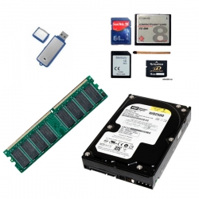

### 1.2. Память в структуре ЭВМ

В модели фон Неймана команды и данные находятся в общей памяти. Процессор выбирает команды, считывает операнды, выполняет операции и сохраняет результаты.

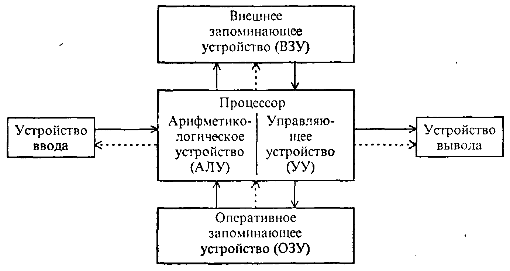

**АЛУ** выполняет арифметические и логические операции. **Устройство управления** организует последовательность действий. **ОЗУ** предоставляет рабочее пространство для команд и данных. **Внешнее ЗУ** сохраняет их между запусками.

### 1.3. Бит, байт, слово, блок, сегмент

| Понятие | Определение |
| --- | --- |
| **Бит** | Один двоичный разряд, принимающий значение `0` или `1` |
| **Байт** | Группа из 8 бит |
| **Адрес** | Число, идентифицирующее адресуемую единицу памяти |
| **Машинное слово** | Порция данных, размер которой определяется архитектурой и принятой терминологией |
| **Блок** | Группа данных, рассматриваемая как единица хранения, передачи или распределения |
| **Страница** | Блок фиксированного размера в страничной организации памяти |
| **Сегмент** | Логически выделенная часть адресного пространства, например код, данные или стек |

В рассматриваемой байтовой модели оперативная память представляет собой линейную последовательность адресуемых байтов. Если память содержит `N` байт, их адреса идут от `0` до `N − 1`.

Соседние байты объединяются в более крупные группы. Можно выделить группы по 2, 4 и 8 байт:

| Размер группы | Число бит | Число байт |
| --- | --- | --- |
| 16 разрядов | 16 | 2 |
| 32 разряда | 32 | 4 |
| 64 разряда | 64 | 8 |

Название «слово» зависит от контекста. Например, в терминологии x86 слово — это 16 бит, двойное слово — 32 бита. Размер адресуемой ячейки не обязательно составляет четыре байта. Команда также может занимать несколько адресуемых единиц, а не обязательно одну ячейку или одно слово.

Для двоичных объёмов удобно использовать обозначения:

```text
1 КиБ = 2¹⁰ байт = 1024 байта
1 МиБ = 2²⁰ байт = 1024 КиБ
1 ГиБ = 2³⁰ байт = 1024 МиБ
1 ТиБ = 2⁴⁰ байт = 1024 ГиБ
```

При расчётах нужно различать **бит** и **байт**, а также двоичные и десятичные приставки.

## 2. Классификация запоминающих устройств

Память классифицируют по способу реализации и сохранению информации.

| Группа | Примеры | Основное назначение |
| --- | --- | --- |
| Электронная память | ОЗУ, ПЗУ, флэш-память | Рабочее хранение данных и хранение встроенных программ |
| Магнитные диски | Жёсткие и гибкие диски | Длительное хранение с доступом к отдельным блокам |
| Магнитные ленты | Ленты ленточных накопителей | Резервные копии и архивы |
| Оптические диски | CD и перезаписываемые оптические носители | Распространение и хранение данных |
| Магнитооптические диски | Носители с сочетанием магнитной записи и оптических методов | Длительное хранение данных |

### 2.1. Энергозависимость

**Энергозависимая память** сохраняет данные, пока получает питание. При отключении питания её содержимое теряется. К этой группе относятся обычные SRAM и DRAM.

**Энергонезависимая память** сохраняет данные без питания. Примеры: ПЗУ и флэш-память. Магнитные и оптические носители также не требуют постоянного питания для сохранения записанной информации.

Сохранность без питания не означает невозможность повреждения или изменения данных.

### 2.2. ОЗУ — RAM

**ОЗУ**, оперативное запоминающее устройство, хранит команды и данные, с которыми процессор работает во время выполнения программ. Английское название **RAM — Random Access Memory**, память с произвольным доступом.

Произвольный доступ означает возможность обратиться по адресу к нужной ячейке без последовательного чтения всех предшествующих ячеек.

В ОЗУ находятся:

- выполняемые участки программ и ОС;
- рабочие данные приложений;
- стеки, служебные структуры и буферы.

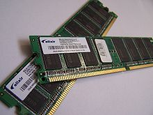

После выключения компьютера содержимое обычного ОЗУ исчезает. Для длительного сохранения результатов программа должна записать их на энергонезависимый носитель.

### 2.3. ПЗУ — ROM

**ПЗУ**, постоянное запоминающее устройство, предназначено для хранения информации, которую во время обычной работы преимущественно читают. Английское название **ROM — Read Only Memory**.

В классическом ПЗУ содержимое задаётся при изготовлении. Существуют также программируемые и перепрограммируемые разновидности постоянной памяти. Следовательно, «только для чтения» не означает, что любая память для встроенных программ принципиально не допускает обновления.

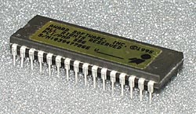

ПЗУ сохраняет информацию при выключении питания. Это означает сохранение данных, а не продолжение выполнения программ.

### 2.4. BIOS

**BIOS — Basic Input/Output System**, базовая система ввода-вывода, — встроенное программное обеспечение компьютера. В модели из презентации оно хранится в микросхеме постоянной памяти на системной плате и доступно до загрузки ОС с диска.

Основные функции BIOS в рассматриваемой схеме:

1. Начальная настройка оборудования после включения питания.
2. Самотестирование основных устройств.
3. Предоставление базовых процедур работы с устройствами.
4. Запуск процедуры загрузки, которая передаёт управление загрузчику ОС.

BIOS относится к **прошивке**: программный код хранится в аппаратном устройстве. Его не следует определять как модуль оперативной памяти или обязательную часть загружаемой ОС.

### 2.5. CMOS и флэш-память

**CMOS**, или **КМОП**, — технология изготовления электронных схем, а не название самостоятельного класса энергонезависимой памяти. В контексте классического ПК «CMOS-памятью» называют небольшую память настроек, сохраняющую содержимое благодаря резервному питанию от батареи.

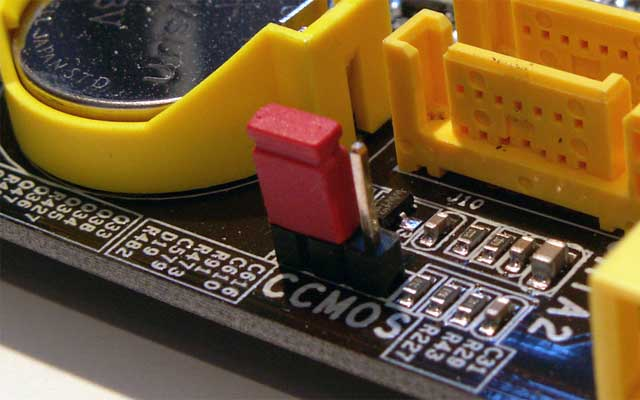

**Флэш-память** — электрически перепрограммируемая энергонезависимая полупроводниковая память. USB-накопитель является устройством на её основе. Сама технология не ограничивается переносными накопителями.


## 3. Иерархия памяти

### 3.1. Зачем нужны уровни памяти

Большую, очень быструю и дешёвую память трудно реализовать одновременно. Поэтому система объединяет устройства с разными характеристиками.

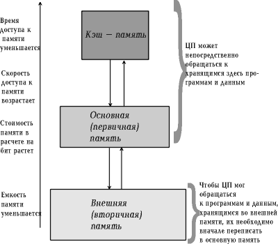

Более подробная последовательность уровней:

```text
Регистры процессора
        ↓
Кэш L1 → кэш L2 → последующие уровни кэша, если предусмотрены
        ↓
Основная оперативная память
        ↓
Внешние накопители
```

При движении от регистров к внешним накопителям обычно увеличиваются вместимость и время доступа, а стоимость хранения одного бита уменьшается. Обратное направление даёт более быстрый доступ при меньшей вместимости.

**Регистры и кэш различаются.** Регистры непосредственно участвуют в выполнении команд, а кэш автоматически хранит копии блоков основной памяти. Выражение «регистровая кэш-память» не должно смешивать эти понятия.

### 3.2. Локальность обращений

Иерархия эффективна благодаря закономерностям работы программ:

- **Временная локальность:** недавно использованные данные или команды могут понадобиться снова. Пример — переменная-счётчик цикла.
- **Пространственная локальность:** после обращения к одному адресу вероятны обращения к соседним. Пример — последовательный обход массива.

Поэтому перенос целого блока в быструю память может ускорить несколько последующих обращений.

## 4. Кэш-память

### 4.1. Назначение и структура кэша

**Кэш-память** — быстрая промежуточная память между процессором и основной памятью. Она хранит копии блоков данных и команд, чтобы сократить среднее время доступа.

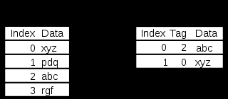

Логически запись кэша включает:

- блок данных, или **строку кэша**;
- **тег** — часть адресной информации для распознавания блока;
- служебные признаки, например признак действительности записи;
- при обратной записи — признак изменения данных.

Точная структура определяется организацией конкретного кэша.

### 4.2. Попадание и промах

**Кэш-попадание, cache hit**, происходит, когда запрошенные данные уже находятся в кэше. Процессор получает их с малого по времени доступа уровня.

**Кэш-промах, cache miss**, возникает, когда нужного блока в кэше нет. Запрос передаётся на следующий уровень. При чтении требуемый блок обычно загружается в кэш, после чего процессор получает данные.

```text
Обращение процессора
        ↓
Проверка кэша
        ├── Попадание → данные из кэша
        └── Промах → следующий уровень памяти → загрузка блока → данные
```

Если свободного места нет, требуется выбрать запись для вытеснения. Таким образом, у кэша есть собственная политика замещения.

**Коэффициент попаданий**:

```text
h = число попаданий / общее число обращений
Коэффициент промахов = 1 − h
```

Например, при 950 попаданиях из 1000 обращений `h = 0,95`, или `95 %`. Остальные `5 %` обращений требуют обработки промаха.

Для упрощённой одноуровневой модели:

```text
Среднее время доступа = время проверки кэша + (1 − h) × штраф промаха
```

Здесь штраф промаха — дополнительное время после проверки кэша. Если проверка занимает 2 нс, штраф — 60 нс, а `h = 0,95`, среднее время равно `2 + 0,05 × 60 = 5 нс`. Это учебный расчёт, а не характеристика оборудования из презентации.

### 4.3. Политики записи

| Политика | Как выполняется запись | Следствие |
| --- | --- | --- |
| **Сквозная запись, write-through** | Обновление кэша сопровождается передачей записи на следующий уровень памяти | Следующий уровень получает изменения при каждой записи |
| **Обратная запись, write-back** | Изменяется строка кэша и устанавливается признак модификации. На следующий уровень данные передаются позднее, например при вытеснении | Уменьшается количество записей на следующий уровень, но требуется отслеживать изменённые строки |

В многоуровневом кэше «следующий уровень» не обязательно означает сразу ОЗУ. Связанность обновлений не требует их физического завершения в один момент.

### 4.4. Уровни кэша

**L1** — ближайший к вычислительному ядру уровень, рассчитанный на малое время доступа. **L2** предоставляет дополнительную вместимость при большем времени доступа. Если архитектура предусматривает другие уровни, они продолжают эту иерархию.

Количество уровней, объём, расположение и совместное использование кэша зависят от процессора. Количество внутренних регистров нельзя выводить только из разрядности процессора.

В презентации также рассматривается кэш браузера: идентификатором служит URL, данными — сохранённое содержимое ресурса. Это пример общего принципа кэширования, хотя устройство такого кэша отличается от аппаратного кэша процессора.

## 5. Основная и внешняя память

### 5.1. Обмен процессора с ОЗУ

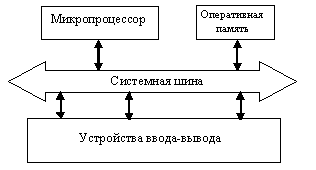

При чтении процессор задаёт адрес и операцию чтения, а память возвращает данные. При записи процессор передаёт адрес, данные и сигнал записи. В учебной модели линии системной шины разделяются на шины адреса, данных и управления.

Если обращение обслуживает кэш, физический обмен с основной памятью для каждого отдельного чтения не требуется.

### 5.2. SRAM и DRAM

| Характеристика | SRAM | DRAM |
| --- | --- | --- |
| Расшифровка | Static RAM | Dynamic RAM |
| Хранение бита | Устойчивое состояние триггерной ячейки | Заряд конденсатора, доступ к которому управляется транзистором |
| Регенерация | Периодическое восстановление заряда не требуется | Нужна периодическая регенерация из-за утечки заряда |
| Быстродействие | Обычно выше | Обычно ниже, чем у SRAM |
| Плотность хранения | Обычно ниже | Обычно выше |
| Стоимость одного бита | Обычно выше | Обычно ниже |
| Типичное назначение | Кэш и небольшие быстрые запоминающие устройства | Основная оперативная память |

Оба вида в обычном исполнении энергозависимы. Слово «статическая» означает способ удержания состояния при наличии питания. Оно не означает сохранность после отключения питания.

Сравнение энергопотребления зависит от реализации и режима работы. Безусловно меньшее энергопотребление SRAM не следует считать общим правилом.

### 5.3. Адресуемый объём

Если адрес имеет `n` бит, то он может представить `2ⁿ` разных значений. При байтовой адресации это даёт `2ⁿ` байт адресного пространства.

```text
32 бита адреса → 2³² байт = 4 ГиБ
```

**Адресное пространство и установленная физическая память — разные величины.** На доступный объём влияют аппаратная адресация, отображение устройств, механизмы расширения адресов и ограничения ОС.

Значения 4 ГБ и 192 ГБ для Windows нельзя считать универсальными пределами для всех 32- и 64-разрядных систем. Из разрядности самой по себе не следует конкретный предел используемой физической памяти ОС.

### 5.4. Видеопамять

**Видеопамять** хранит данные для обработки и вывода изображения: буферы кадров, текстуры и другие графические ресурсы. В презентации она обозначена как VRAM и рассматривается как разновидность оперативной памяти.

### 5.5. Жёсткий диск

**HDD — Hard Disk Drive**, накопитель на жёстких магнитных дисках, хранит информацию посредством магнитной записи. Он предоставляет доступ к блокам данных и сохраняет информацию без питания.


Доступ к HDD связан с механическим перемещением головок и вращением дисков, поэтому он значительно медленнее обращения к ОЗУ. Это особенно важно при подкачке: использование диска позволяет хранить больше данных, но не делает диск равным оперативной памяти по скорости.

### 5.6. Магнитная лента

**Стример**, или ленточный накопитель, записывает данные на магнитную ленту. Для него характерен последовательный доступ: чтобы добраться до нужного участка, требуется переместить ленту.

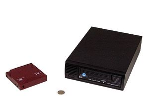

Лента подходит для хранения больших наборов данных и резервных копий. Последовательный характер доступа затрудняет частые обращения к небольшим произвольным фрагментам.

## 6. Функции ОС по управлению памятью

Оперативная память — ресурс мультипрограммной ОС. Несколько процессов нуждаются в памяти одновременно, а ОС должна распределять её и защищать содержимое процессов.

Основные функции:

1. **Учёт памяти.** Отслеживание занятых и свободных областей.
2. **Выделение.** Предоставление памяти процессам и служебным структурам.
3. **Освобождение.** Возврат областей после завершения процесса или прекращения их использования.
4. **Перемещение данных.** Организация загрузки и выгрузки между ОЗУ и внешней памятью.
5. **Отображение адресов.** Настройка соответствия между адресами процесса и физической памятью.
6. **Защита.** Ограничение доступа к памяти других процессов и ядра.

### Защита и разрешённое совместное использование

Защита должна препятствовать неразрешённому чтению, записи и выполнению. Её обеспечивают ОС и аппаратные средства совместно: ОС задаёт правила, а аппаратура проверяет обращения.

Полная изоляция не исключает **разделяемую память**. ОС может разрешить нескольким процессам доступ к одному физическому участку и определить права каждого из них.

## 7. Стратегии управления памятью

Стратегии управления памятью отвечают на три вопроса.

| Стратегия | Главный вопрос | Примеры решений |
| --- | --- | --- |
| **Выборка, или вталкивание** | Когда загружать блок? | По требованию или с упреждением |
| **Размещение** | Куда загружать блок? | Первый подходящий, наилучший или наибольший свободный участок |
| **Замещение, или выталкивание** | Какой блок удалить, если места не хватает? | FIFO, LRU, LFU, случайный выбор |

### 7.1. Выборка

**Выборка по требованию:** блок загружается, когда процесс обращается к отсутствующей части программы или данных. Она позволяет не загружать то, что не понадобится, но первое обращение может вызвать задержку.

**Упреждающая выборка:** система пытается заранее загрузить блоки, которые, вероятно, потребуются. Основанием служат последовательное выполнение и локальность обращений. Удачное предсказание уменьшает ожидание, ошибочное расходует память и пропускную способность.

Эти способы могут сочетаться. Выбор стратегии зависит от системы и характера обращений.

### 7.2. Размещение в свободных участках

Эти алгоритмы особенно существенны при выделении непрерывных областей переменного размера:

- **First fit, первый подходящий:** выбирается первый достаточно большой участок. Обычно требует меньше поиска.
- **Best fit, наиболее подходящий:** выбирается наименьший участок, в который помещается запрос. Остаток после конкретного выделения минимален, но могут накапливаться маленькие свободные промежутки.
- **Worst fit, наименее подходящий:** выбирается самый большой участок в расчёте на то, что остаток останется пригодным для других запросов.

**Пример.** Свободные участки в порядке просмотра: `100, 500, 200, 300 КиБ`. Запрос — `180 КиБ`.

| Алгоритм | Выбранный участок | Остаток |
| --- | --- | --- |
| First fit | 500 КиБ | 320 КиБ |
| Best fit | 200 КиБ | 20 КиБ |
| Worst fit | 500 КиБ | 320 КиБ |

Для страниц одинакового размера задача другая: достаточно свободного кадра, подбирать участок по размеру страницы не нужно.

### 7.3. Замещение

| Алгоритм | Как выбирается блок | Особенность |
| --- | --- | --- |
| Случайный | Произвольным образом из допустимых кандидатов | Не требует подробной истории обращений |
| **FIFO** | Загруженный раньше остальных | Учитывает время загрузки, а не полезность блока |
| **LRU — Least Recently Used** | Дольше остальных не использовавшийся | Использует давность последнего обращения |
| **LFU — Least Frequently Used** | Использовавшийся реже остальных | Требует учёта частоты обращений |
| **NUR**, как обозначено в презентации | Не использовавшийся в последнее время | Опирается на признаки недавних обращений, а не обязательно на точный порядок |

**LRU и LFU различаются:** первый оценивает давность, второй — частоту. Блок мог часто использоваться в прошлом, но давно не использоваться сейчас.

Если вытесняемый блок содержит изменения, которые требуется сохранить, перед повторным использованием его памяти изменения должны попасть во внешнее хранилище. Это увеличивает цену замещения.

## 8. Организация реальной памяти

Под реальной памятью здесь понимается физическая оперативная память. В простых схемах процессу выделяют непрерывную область.

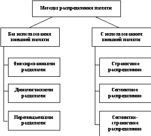

### 8.1. Однопрограммная организация

Часть памяти занимает ОС, а оставшуюся область предоставляют одной пользовательской программе.

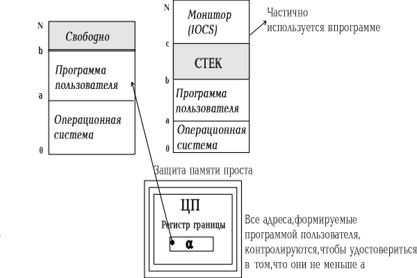

**Достоинство:** простота распределения и проверки границ. **Недостатки:** оставшаяся память может не использоваться, а при ожидании ввода-вывода процессору нечем заменить единственную программу.

Защиту можно строить на проверке допустимого диапазона адресов. В конкретной схеме могут использоваться нижняя и верхняя границы либо база и длина области.

### 8.2. Фиксированные разделы

Память заранее разбивается на несколько разделов. В каждом размещается один процесс. Размеры разделов могут различаться, но во время работы данной схемы они фиксированы.

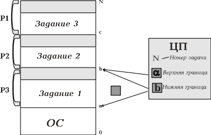

Преимущества — простое управление и возможность переключать процессор между несколькими заданиями. Ограничения:

- число одновременно размещённых процессов ограничено числом разделов;
- процесс должен помещаться целиком в один подходящий раздел;
- неиспользованный остаток внутри занятого раздела недоступен другим процессам.

Последняя потеря называется **внутренней фрагментацией**. Например, при размере раздела 100 КиБ и размере процесса 70 КиБ внутри выделенного раздела остаётся 30 КиБ.

### 8.3. Динамические разделы

Разделы заранее не создаются. Для каждого процесса ОС выделяет непрерывный участок нужного размера. После завершения процесса участок освобождается, а соседние свободные области можно объединить.

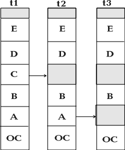

Преимущество — отсутствие необходимости подгонять процесс под заранее заданный раздел. Основная проблема — появление свободных промежутков между занятыми областями, то есть **внешняя фрагментация**.

Например, есть свободные участки 20, 30 и 50 КиБ. Всего свободно 100 КиБ, но процесс размером 80 КиБ не поместится ни в один непрерывный участок.

> Внутренняя фрагментация — потери **внутри выделенных блоков**. Внешняя — свободная память **между выделенными областями**, разбитая на слишком маленькие участки.

### 8.4. Перемещаемые разделы и уплотнение

Чтобы бороться с внешней фрагментацией, занятые области можно переместить ближе друг к другу. Свободные промежутки объединятся в одну большую область.

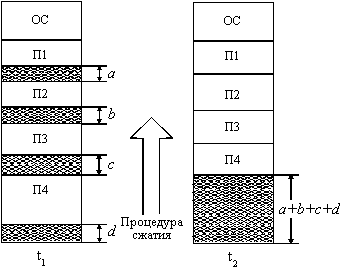

В презентации операция называется **сжатием**. Здесь точнее понимать её как **уплотнение**: объём данных не уменьшается, меняются их адреса.

ОС должна:

1. Перенести содержимое занятых областей.
2. Обновить сведения об их расположении.
3. Обеспечить корректность адресов после перемещения.
4. Объединить освободившиеся области.

Уплотнение требует времени на копирование и механизма перемещения адресов. Оно может выполняться при накоплении промежутков или при невозможности удовлетворить новый крупный запрос.

### 8.5. Сравнение схем

| Схема | Выделение памяти | Основная проблема |
| --- | --- | --- |
| Однопрограммная | Одна непрерывная пользовательская область | Слабое использование ресурсов при ожиданиях |
| Фиксированные разделы | Один заранее заданный раздел на процесс | Внутренняя фрагментация и ограничение размера процесса |
| Динамические разделы | Непрерывный участок по размеру запроса | Внешняя фрагментация |
| Перемещаемые разделы | Динамические участки с возможностью уплотнения | Затраты на перемещение и обновление адресов |

## 9. Использование внешней памяти: оверлеи и свопинг

Процессор должен получить выполняемую команду и нужные данные через доступные ему уровни памяти. Однако вся программа не обязана одновременно находиться в ОЗУ.

### 9.1. Оверлеи

**Оверлей** — часть программы, которая загружается в область памяти, совместно используемую несколькими частями программы в разное время.

В памяти оставляют постоянно необходимую часть и только те модули, которые нужны на текущем этапе. Завершившийся модуль может быть заменён следующим.

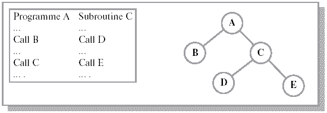

Разбиение и допустимый порядок загрузки планирует программист или система подготовки программы. Например, две подпрограммы, которые никогда не нужны одновременно, могут занимать одну область по очереди.

Преимущество — выполнение программы, суммарный объём модулей которой превышает доступное ОЗУ. Недостаток — сложность проектирования и зависимость структуры программы от ограничений памяти.

### 9.2. Свопинг

**Свопинг** в терминологии презентации — выгрузка образа процесса на диск и возвращение его в ОЗУ **целиком**.

Последовательность:

1. ОС выбирает процесс, который временно можно убрать из ОЗУ, например ожидающий ресурс.
2. Сохраняет его образ во внешней памяти.
3. Использует освобождённую область для другого процесса.
4. При необходимости возвращает сохранённый процесс в ОЗУ.
5. После восстановления процесс продолжает выполнение.

Процесс остаётся известен ОС и во время отсутствия его образа в ОЗУ. При обратной загрузке физическое размещение может измениться, поэтому требуется соответствующая поддержка адресации.

Недостаток свопинга — большой объём обмена, даже если для продолжения работы нужна небольшая часть процесса.

## 10. Концепция виртуальной памяти

### 10.1. Адресное пространство процесса

**Виртуальная память** — механизм, который отделяет адресное пространство процесса от физического размещения данных. Процесс обращается к виртуальным адресам, а аппаратные средства и ОС обеспечивают их отображение в физическую память.

Требуемые части могут загружаться по мере необходимости. Благодаря этому программа может работать, хотя все её страницы или сегменты не находятся в ОЗУ одновременно.

```text
Виртуальное адресное пространство процесса
        ↓ отображение адресов
Физические кадры ОЗУ
        ↕ загрузка и выгрузка необходимых частей
Внешнее хранилище
```

**Файл подкачки** — возможное место хранения выгруженных данных. Он является частью реализации, а не полным определением виртуальной памяти. Некоторые страницы могут восстанавливаться из исполняемого файла, а некоторые области вообще не требуют хранения на диске до обращения к ним.

Объём виртуальной памяти также конечен: его ограничивают архитектура и ОС. Выражение «практически неограниченная память» описывает удобную для программы абстракцию, а не отсутствие пределов.

### 10.2. Цели и обязанности системы

Виртуальная память позволяет:

- выполнять программы без одновременного размещения всего образа в ОЗУ;
- избавить программиста от ручного планирования загрузки частей, характерного для оверлеев;
- независимо размещать части разных процессов;
- сочетать изоляцию процессов с разрешённым совместным использованием памяти.

ОС ведёт таблицы отображения и права доступа, выбирает загружаемые и вытесняемые блоки. Аппаратура выполняет преобразование адресов и обнаруживает недопустимые обращения или отсутствие блока.

Виртуальная память не устраняет стоимость обращения к диску. При нехватке ОЗУ частые загрузки и выгрузки могут резко снизить производительность.

### 10.3. Сравнение подходов

| Подход | Единица загрузки и выгрузки | Кто определяет размещение частей |
| --- | --- | --- |
| Оверлеи | Заранее выделенный модуль программы | Программист и средства подготовки программы |
| Свопинг в смысле презентации | Образ процесса целиком | ОС |
| Виртуальная память с подкачкой | Страница или сегмент | ОС совместно с аппаратным механизмом отображения |

## 11. Виды адресов

Различают символьные, виртуальные и физические адреса.

| Вид | Смысл | Пример |
| --- | --- | --- |
| **Символьный** | Имя объекта в исходной программе | Имя переменной `counter` или метка подпрограммы |
| **Виртуальный** | Адрес в адресном пространстве процесса | Номер виртуальной страницы и смещение |
| **Физический** | Адрес в физической оперативной памяти | Начало кадра плюс смещение |

В процессе подготовки программы имена связываются с адресами или смещениями. Конкретная работа распределяется между транслятором, компоновщиком и загрузчиком. Представление, будто транслятор всегда назначает все виртуальные адреса начиная с нуля, — учебное упрощение.

Одинаковые виртуальные адреса двух процессов могут соответствовать разным физическим областям. И наоборот, разные виртуальные адреса могут отображаться на одну общую физическую область.

## 12. Страничная организация виртуальной памяти

### 12.1. Страницы и кадры

Виртуальное адресное пространство процесса делится на **виртуальные страницы** одинакового размера. Физическая память делится на блоки того же размера — **кадры**, или физические страницы.

Страницы процесса могут размещаться в несмежных кадрах. Для выделения очередной страницы не требуется непрерывная область размером со весь процесс.

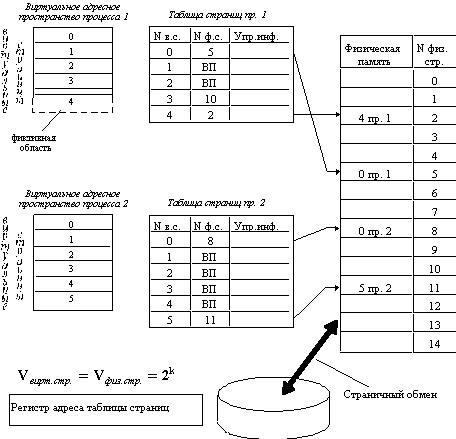

Размер страницы обычно выбирается степенью двойки. Если `S = 2ᵏ` байт, младшие `k` бит адреса представляют смещение, остальные — номер виртуальной страницы.

### 12.2. Преобразование адреса

Виртуальный адрес представляется парой:

```text
V = (p, d)
p — номер виртуальной страницы
d — смещение внутри страницы, 0 ≤ d < S
```

Таблица страниц устанавливает соответствие `p → f`, где `f` — номер физического кадра. Смещение при преобразовании не меняется:

```text
Физический адрес r = f × S + d
```

Нужно различать виртуальную пару `(p, d)` и физическую пару `(f, d)`.

**Пример.** Размер страницы — 1024 байта, виртуальный адрес — 2500. Тогда:

```text
p = 2500 div 1024 = 2
d = 2500 mod 1024 = 452
```

Если таблица отображает страницу 2 в кадр 7, физический адрес равен:

```text
r = 7 × 1024 + 452 = 7620
```

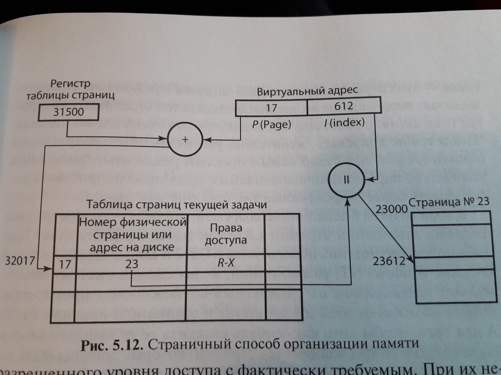

### 12.3. Таблица страниц

Для каждой виртуальной страницы запись таблицы может хранить:

- номер физического кадра, если страница присутствует в ОЗУ;
- **признак присутствия**;
- права чтения, записи и выполнения;
- **признак модификации** — менялась ли страница;
- **признак обращения** — использовалась ли страница;
- другие сведения, необходимые аппаратуре и ОС.

Сведения о месте хранения отсутствующей страницы могут находиться в служебных структурах ОС. Не следует считать, что любая аппаратная запись таблицы обязательно содержит готовый дисковый адрес.

### 12.4. Отсутствующая страница

Если обращение допустимо, но нужной страницы нет в ОЗУ, возникает **страничное исключение**, или **page fault**.

1. Аппаратура передаёт управление ОС.
2. ОС проверяет допустимость адреса и тип доступа.
3. Находит свободный кадр или выбирает страницу для вытеснения.
4. При необходимости сохраняет изменённую вытесняемую страницу.
5. Загружает нужные данные либо подготавливает страницу другим предусмотренным способом.
6. Обновляет таблицы отображения.
7. Возобновляет выполнение прерванного обращения.

Если адрес недопустим или права нарушены, загрузка страницы не исправляет обращение: ОС обрабатывает ошибку доступа.

### 12.5. Достоинства и ограничения

Страничная организация устраняет необходимость подбирать непрерывный физический участок под весь процесс и избегает внешней фрагментации при распределении одинаковых кадров.

При этом возможна **внутренняя фрагментация**: последняя страница выделенной области может использоваться не полностью. Дополнительные расходы создают таблицы страниц, преобразование адресов и обработка страничных исключений.

### 12.6. Двухуровневые таблицы страниц

Двухуровневая страничная организация — вариант построения таблиц при той же страничной модели.

Виртуальный адрес делится на индекс первого уровня, индекс второго уровня и смещение. Первая таблица указывает на нужную таблицу второго уровня, а вторая — на физический кадр.

Такой подход позволяет не создавать таблицы второго уровня для неиспользуемых частей адресного пространства. Цена — дополнительные этапы поиска отображения, если их не ускоряют специальные аппаратные средства.

## 13. Сегментная организация

### 13.1. Сегмент как логическая часть программы

В сегментной организации адресное пространство состоит из частей **переменного размера**. Сегмент может соответствовать коду, данным, стеку или другой логически выделенной области.

Разные сегменты процесса могут занимать несмежные физические области. В простой сегментной модели каждый присутствующий сегмент размещается внутри собственной непрерывной области.

### 13.2. Дескриптор сегмента

ОС формирует таблицу сегментов. **Дескриптор сегмента** содержит его базовый адрес, длину или предел, права доступа и сведения о присутствии.

Длина принципиальна: сегменты имеют разные размеры, поэтому смещение требуется проверять на допустимость.

```text
V = (g, s)
g — номер сегмента
s — смещение относительно его начала

Условие для сегмента длиной L: 0 ≤ s < L
Физический адрес r = base[g] + s
```

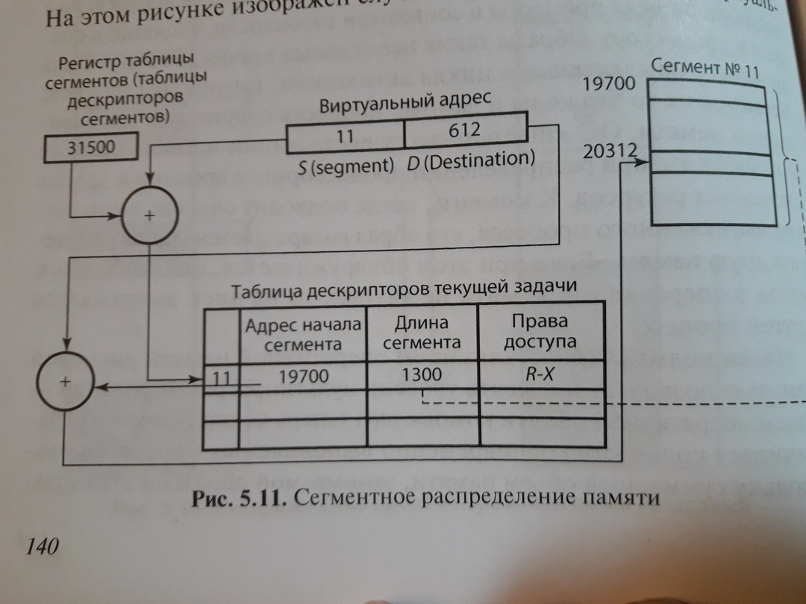

**Пример из презентации:** номер сегмента — 11, смещение — 612, начальный физический адрес сегмента — 19700. При допустимом смещении:

```text
r = 19700 + 612 = 20312
```

Если сегмент отсутствует, система должна обработать отсутствие и при допустимом обращении загрузить его. Если смещение выходит за границы или нарушает права доступа, возникает ошибка.

### 13.3. Преимущества и недостатки

Сегментация отражает логическую структуру программы и позволяет задавать отдельные права разным частям. Но переменный размер сегментов приводит к внешней фрагментации и необходимости поиска подходящих свободных областей.

Скорость преобразования зависит от аппаратной реализации. Сегментная адресация не обязательно медленнее страничной.

### 13.4. Разделяемые сегменты

Несколько процессов могут отображать свои сегменты на одну физическую область.

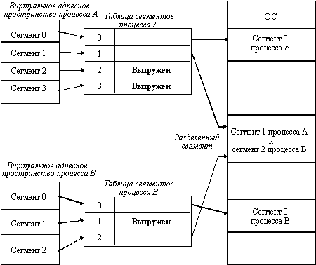

Пример — общий код библиотеки, доступный для чтения и выполнения. Для совместно изменяемых данных дополнительно нужна синхронизация. ОС должна учитывать все отображения общей области при управлении её размещением.

## 14. Сегментно-страничная организация

Этот способ объединяет логическое деление на сегменты и физическое распределение страницами:

1. Виртуальное пространство процесса делится на сегменты.
2. Каждый сегмент разбивается на страницы одинакового размера.
3. Физическая память делится на кадры.
4. Страницы сегментов размещаются в доступных кадрах независимо друг от друга.

Виртуальный адрес имеет три компонента:

```text
V = (g, p, d)
g — номер сегмента
p — номер страницы внутри сегмента
d — смещение внутри страницы
```

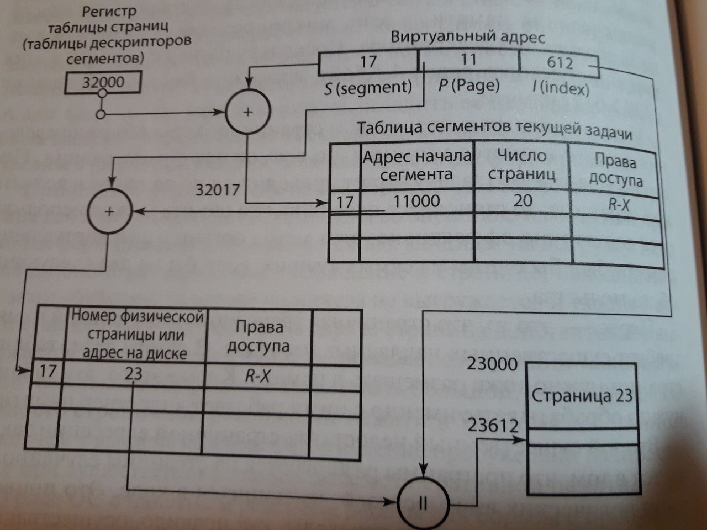

По номеру сегмента находят его дескриптор и таблицу страниц. По номеру страницы получают физический кадр. После проверки присутствия и прав формируют адрес `f × S + d`.

Преимущество — логическая организация сегментами без требования выделять целому сегменту непрерывную физическую область. Недостаток — усложнение таблиц и дополнительные этапы преобразования. Как и при обычной страничной организации, возможны потери внутри неполностью заполненных страниц.

## 15. Динамическое преобразование адресов — ДПА

### 15.1. Суть механизма

**ДПА** устанавливает соответствие виртуальных и физических адресов во время выполнения программы. Оно позволяет менять физическое размещение частей процесса без изменения используемых программой виртуальных адресов.

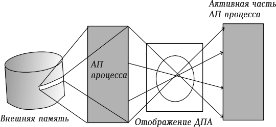

ОС подготавливает таблицы, а аппаратный механизм управления памятью использует их при обращениях. При переключении адресного пространства система выбирает соответствующий набор таблиц.

### 15.2. Обобщённая схема

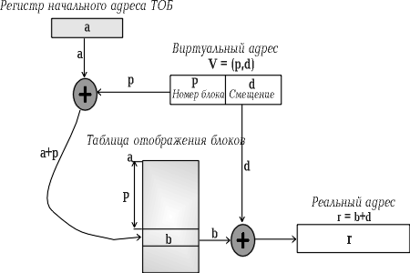

На схеме:

- `a` — адрес начала таблицы отображения блоков;
- `p` — номер виртуального блока;
- `d` — смещение;
- `b` — физическое начало найденного блока;
- `r` — итоговый физический адрес.

Упрощённый алгоритм:

1. По номеру `p` выбрать запись таблицы процесса.
2. Проверить присутствие блока и допустимость доступа.
3. При необходимости передать управление ОС для загрузки блока.
4. Получить физическое начало `b`.
5. Вычислить `r = b + d`.

Для страниц, если запись содержит номер кадра `f`, сначала получают `b = f × S`. Для сегментов требуется также проверить границу смещения.

### 15.3. Размер блока

При выборе размера блока возникает компромисс:

| Увеличение размера блока | Уменьшение размера блока |
| --- | --- |
| Для того же адресного пространства требуется меньше записей отображения | Требуется больше записей отображения |
| При загрузке переносится больше данных | Одна загрузка переносит меньше данных |
| Может усиливаться внутренняя фрагментация при фиксированных блоках | Можно точнее выделять память под небольшой объём данных |
| Выгодно при использовании соседних данных | Выгодно, если большие соседние области не нужны |

Нельзя выбирать размер только по одному показателю: важны накладные расходы таблиц, характер обращений и стоимость обмена с накопителем.

## 16. Сравнение способов виртуальной организации

| Признак | Страничная | Сегментная | Сегментно-страничная |
| --- | --- | --- | --- |
| Единица организации | Страница фиксированного размера | Сегмент переменного размера | Сегменты, разбитые на страницы |
| Адрес | Номер страницы и смещение | Номер сегмента и смещение | Номер сегмента, номер страницы, смещение |
| Структуры отображения | Таблица страниц | Таблица сегментов | Таблица сегментов и таблицы страниц |
| Непрерывная область под весь процесс | Не требуется | Не требуется | Не требуется |
| Непрерывная область под целый сегмент | Не применяется | Требуется в простой модели | Не требуется |
| Характерная фрагментация | Внутренняя | Внешняя | Внутренняя на уровне страниц |
| Отражение логической структуры программы | Непосредственно не задаётся страницами | Есть | Есть |

## 17. Что нужно запомнить

- ОЗУ хранит рабочие данные и команды, внешние накопители — информацию для длительного использования.
- Энергозависимость характеризует сохранение данных без питания. Способ доступа и возможность перезаписи — другие свойства памяти.
- Кэш ускоряет обращения за счёт хранения копий блоков. Его эффективность зависит от попаданий и стоимости промахов.
- SRAM обычно используют там, где важна скорость, DRAM — там, где нужна большая вместимость основной памяти.
- ОС учитывает, выделяет, освобождает и защищает память, управляет размещением и отображением адресов.
- Выборка отвечает на вопрос «когда загрузить», размещение — «куда», замещение — «что вытеснить».
- Внутренняя фрагментация находится внутри выделенных блоков, внешняя — между занятыми областями.
- Свопинг в терминологии лекции перемещает процесс целиком, подкачка виртуальной памяти — его части.
- Виртуальный адрес относится к пространству процесса, физический — к реальному размещению в ОЗУ.
- Страницы одинаковы по размеру, сегменты соответствуют логическим частям и могут иметь разную длину.
- При страничной адресации меняется номер страницы на номер кадра, а смещение сохраняется.
- Виртуальная память требует совместной работы ОС и аппаратного механизма преобразования адресов.
