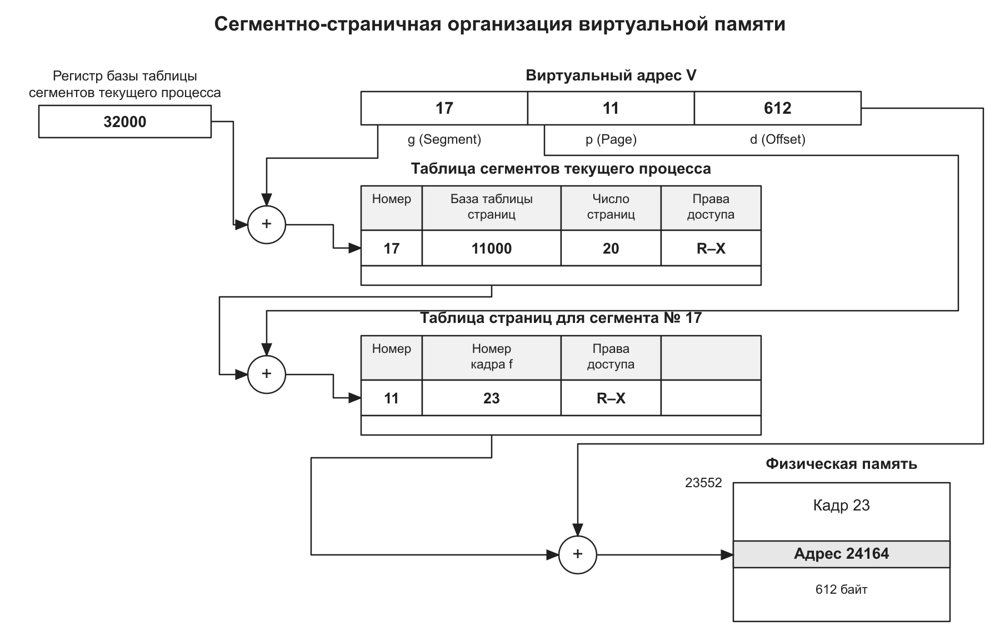

# Домашние задание 5

## Что надо сделать

Вам нужно написать подробный конспект и сделать схему работы виртуальной памяти по сегментной страничной архитектуре.

## Решение

1. [Конспект](<../class/memory-and-memory-management.md>)

2. 
