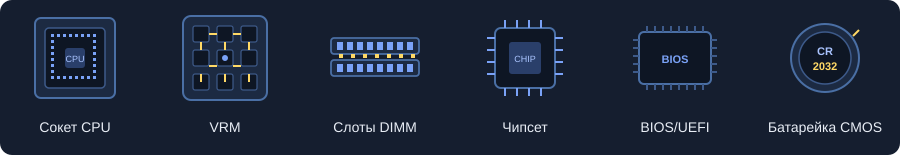
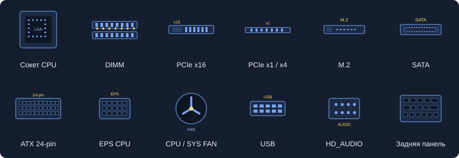

# Материнская плата

**Материнская плата** — основная плата компьютера. Она соединяет процессор, оперативную память, накопители и периферию, распределяет питание и обеспечивает обмен данными.

## 1. Основные компоненты

| Компонент | Назначение |
| --- | --- |
| Сокет | Разъём для установки совместимого процессора |
| VRM | Преобразует и стабилизирует напряжение питания CPU; включает контроллер, силовые транзисторы, дроссели и конденсаторы |
| Слоты DIMM | Предназначены для модулей оперативной памяти |
| Чипсет | Обеспечивает работу периферийных интерфейсов: USB, SATA, дополнительных линий PCIe |
| Микросхема BIOS/UEFI | Хранит прошивку, которая запускает и настраивает оборудование |
| Батарейка CMOS | Поддерживает часы реального времени и, в зависимости от реализации, память настроек при отключённом питании |

## 2. Как запускается компьютер

1. Кнопка питания замыкает контакты **PWR_SW**. Плата подаёт блоку питания сигнал **PS_ON#** для включения основных напряжений.
2. Блок питания стабилизирует напряжения и сообщает о готовности сигналом **PWR_OK**. VRM обеспечивает нужное питание процессора.
3. Процессор выходит из сброса и начинает выполнять код прошивки **BIOS/UEFI**.
4. Прошивка проводит **POST** — начальную проверку оборудования, настраивает память и обнаруживает подключённые устройства. При тренировке RAM подбираются рабочие параметры обмена с памятью.
5. UEFI выбирает загрузочную запись согласно **Boot Order**, запускает загрузчик, который загружает операционную систему.

После загрузки ОС устройства работают под управлением драйверов, а плата продолжает обеспечивать питание, связь компонентов и контроль охлаждения.

## 3. Разъёмы и обмен данными

| Разъём / интерфейс | Что подключается |
| --- | --- |
| PCIe x16 | Обычно видеокарта |
| PCIe x1 / x4 | Сетевые, звуковые карты и другие платы расширения |
| M.2 | SSD; отдельные слоты с другим ключом используются для Wi-Fi |
| SATA | HDD, SATA-SSD, оптические приводы |
| ATX 24-pin | Основное питание материнской платы |
| EPS CPU, обычно 4+4 или 8-pin | Питание процессора |
| CPU_FAN / SYS_FAN | Вентиляторы процессора и корпуса |
| Внутренние USB и HD_AUDIO | USB-порты и аудиоразъёмы передней панели корпуса |
| Задняя панель | Внешние USB, сеть, аудио и другие порты |

**PCIe** передаёт данные по линиям: x1, x4, x8, x16. Чем больше активных линий и выше поколение PCIe, тем больше пропускная способность. Длинный слот x16 может иметь только четыре подключённые линии — нужно смотреть характеристики платы.

Часть устройств подключена напрямую к CPU, часть — через чипсет. Устройства за чипсетом делят пропускную способность его соединения с процессором. **SMBus / I²C** используются для служебного обмена, например чтения датчиков и сведений о памяти.

## 4. Форм-факторы и совместимость

**Форм-фактор** задаёт размеры платы и расположение креплений.

| Форм-фактор | Размер | Особенность |
| --- | --- | --- |
| Mini-ITX | 170 × 170 мм | Компактная плата, мало слотов расширения |
| Micro-ATX | До 244 × 244 мм | Средний размер |
| ATX | 305 × 244 мм | Больше места для слотов и разъёмов |
| E-ATX | Размеры зависят от модели | Требует проверки допустимых размеров в корпусе |

При подборе компонентов проверяют:

- **CPU:** сокет, список поддерживаемых процессоров и необходимую версию BIOS.
- **RAM:** поколение DDR, допустимые объём и параметры памяти. DDR4 и DDR5 невзаимозаменяемы.
- **Корпус:** поддержку форм-фактора и размеры платы.
- **Накопители:** интерфейс, ключ и длину M.2; наличие нужных SATA-портов.
- **Блок питания:** мощность и нужные разъёмы.
- **Линии PCIe:** их распределение; установка M.2 иногда отключает отдельные порты или меняет режим слотов.

Чипсет влияет на набор портов, линий расширения и возможности разгона. Конкретные функции зависят от модели платы и процессора.

## 5. Настройки BIOS/UEFI

- **Boot Order** — порядок выбора загрузочных устройств.
- **XMP / EXPO** — профили частоты, таймингов и напряжения RAM; работа профиля зависит от совместимости компонентов.
- **Smart Fan / Q-Fan** — регулировка оборотов вентиляторов по температуре.
- **Secure Boot** — проверка подписей загрузочного кода согласно доверенным ключам.
- **Разгон и снижение напряжения** — изменение параметров CPU или RAM; после настройки проверяют стабильность и температуру.
- **BIOS Flashback** — обновление прошивки с USB без запуска системы, если плата поддерживает эту функцию.

Источник: предоставленный материал «Материнская плата: как это работает» (`matplata.html`). Иллюстрации извлечены из HTML.
