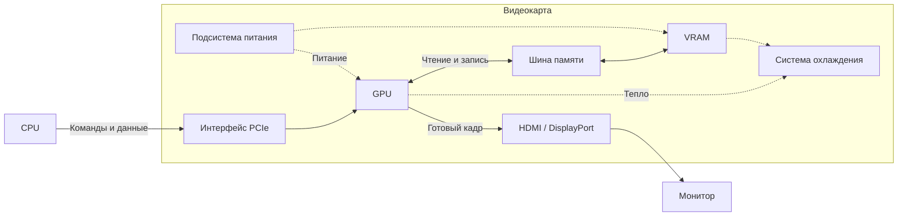

# Домашние задание № 8

## Что надо было сделать

### Часть 1. Теория (краткие ответы)

1. Перечислите **5 основных блоков** видеокарты и укажите назначение каждого.
2. Чем **GPU** отличается от **CPU** по архитектуре? Приведите 2 отличия и объясните, для каких задач выгоден каждый.
3. Что такое **VRAM** и чем она отличается от оперативной памяти компьютера? Почему видеопамять делают максимально быстрой?
4. Объясните своими словами, что такое **SIMT** (Single Instruction, Multiple Threads) и зачем GPU группирует потоки в варпы.
5. Зачем видеокарте **система охлаждения** и **подсистема питания**? Что произойдёт, если охлаждение не справится?

### Часть 2. Схема

1. Нарисуйте (от руки или в редакторе) **упрощённую блок-схему видеокарты**: GPU, VRAM, шина памяти, подсистема питания, охлаждение, интерфейс PCI-E, разъёмы вывода. Подпишите каждый блок и стрелками покажите, как данные идут от CPU к монитору.

### Часть 3. Практика

1. Узнайте модель своей видеокарты (`nvidia-smi`, GPU-Z или настройки системы) и выпишите: **объём VRAM, тип памяти, ширину шины, число ядер (CUDA/шейдерных), TDP**.
2. Посчитайте **пропускную способность памяти** по формуле: частота памяти (МГц) × ширина шины (бит) / 8. Запишите результат в ГБ/с и сравните с паспортным значением.
3. Опишите **по шагам**, что происходит от нажатия «запустить игру» до появления картинки на экране — с упором на роли CPU, GPU и VRAM.

### Часть 4. Вывод

1. В 3–5 предложениях ответьте: **почему видеокарты оказались нужны не только для игр, но и для ИИ?** Свяжите ответ с параллелизмом и типом задач.

## Решение

### Часть 1. Теория

1. **GPU** выполняет вычисления и строит кадры. **VRAM** хранит текстуры, геометрию и кадры. **Шина памяти** передаёт данные между GPU и VRAM. **Подсистема питания (VRM)** стабилизирует напряжение. **Охлаждение** отводит тепло.
2. У CPU меньше, но сложнее ядра. Они быстро выполняют последовательный код и обрабатывают ветвления. У GPU много вычислительных блоков, рассчитанных на одновременную обработку большого числа элементов. CPU подходит для логики игры, GPU — для рендеринга.
3. VRAM — локальная память видеокарты. Оперативная память хранит рабочие данные CPU и программ. Высокая пропускная способность VRAM позволяет GPU одновременно читать текстуры и записывать результаты множества вычислений.
4. SIMT позволяет одной инструкцией управлять группой потоков, каждый из которых обрабатывает свои данные. NVIDIA объединяет по 32 потока в варп, чтобы выдавать инструкцию всей группе сразу.
5. VRM подаёт стабильное питание на GPU и память, а охлаждение отводит их тепло. При перегреве видеокарта снижает частоты, а при критической температуре может отключиться.

### Часть 2. Схема

### Часть 3. Практика

1. **Gigabyte GeForce RTX 5070**  12 ГБ VRAM, GDDR7 (Micron), шина 192 бита, 6144 ядра CUDA. 250 Вт (TGP).
2. Частота памяти 1750 МГц, скорость 28 Гбит/с на линию. Пропускная способность: `28 × 192 / 8 = 672 ГБ/с`. Результат совпадает с паспортным значением NVIDIA.
3. CPU запускает игру, загружает ресурсы и готовит команды отрисовки. Текстуры и геометрия передаются по PCIe в VRAM. GPU читает их, строит кадр и записывает его в VRAM. Контроллер вывода отправляет кадр на монитор через HDMI или DisplayPort.

### Часть 4. Вывод

Нейросети часто выполняют умножение больших матриц. Эти операции можно разбить на множество однотипных вычислений и выполнять параллельно на GPU. Поэтому видеокарты ускоряют обучение и работу нейросетей.
