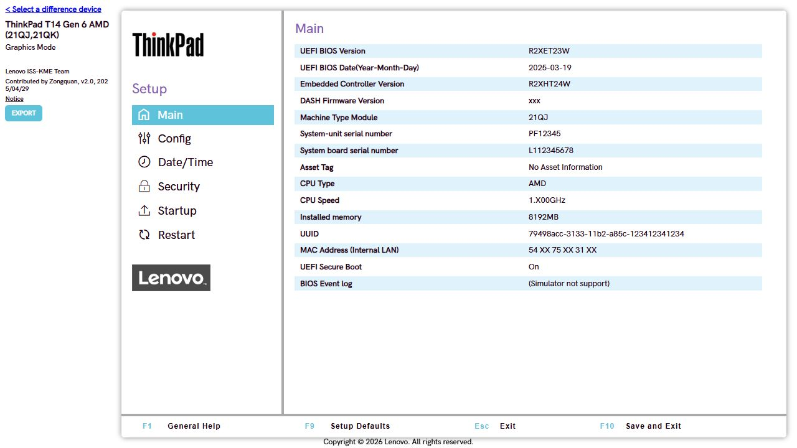
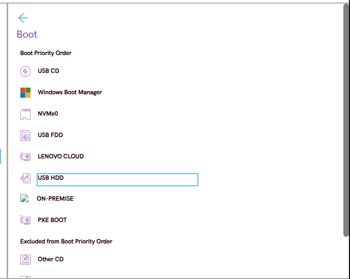
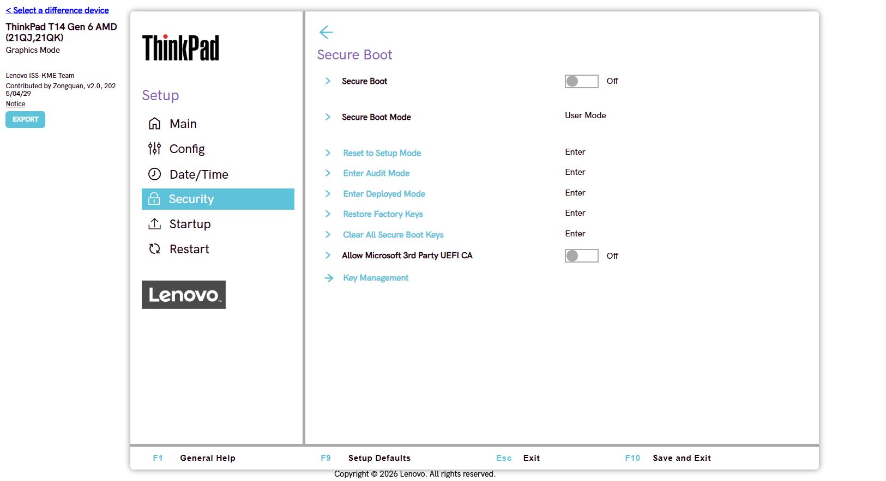
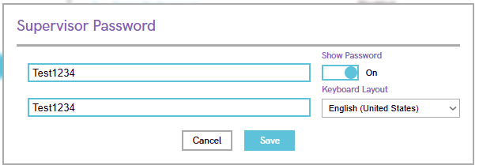
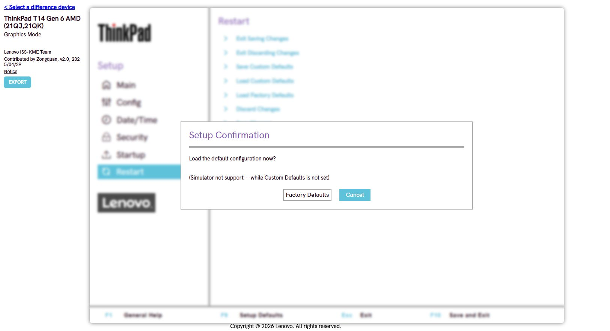
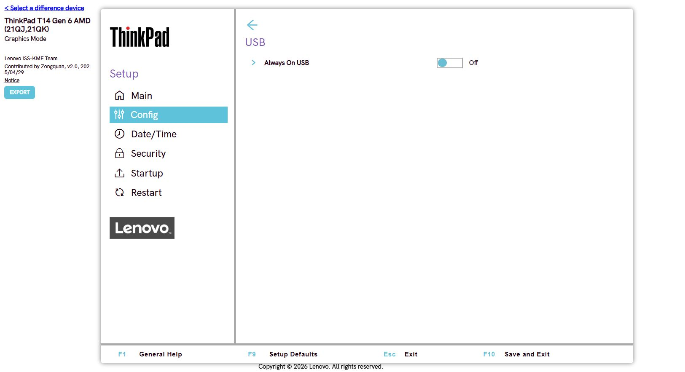
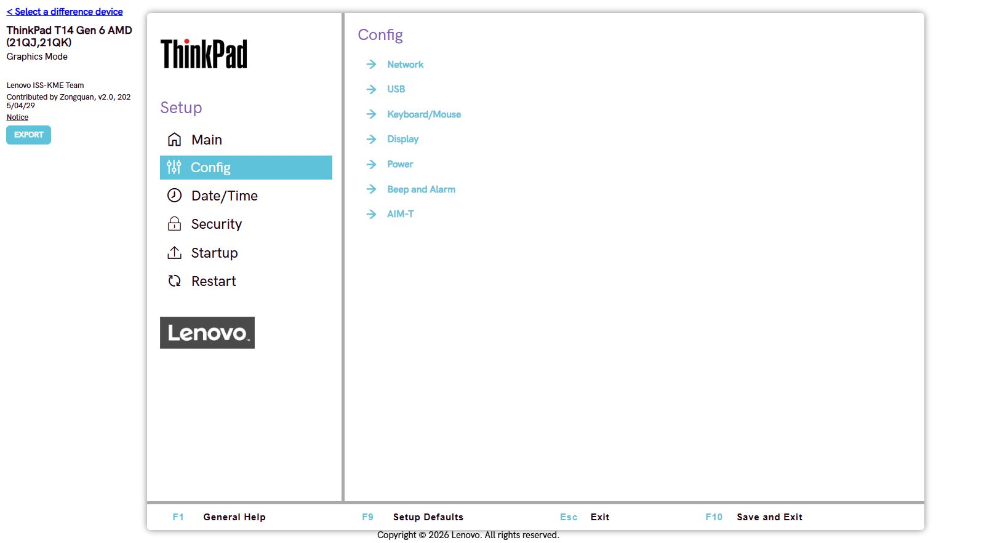
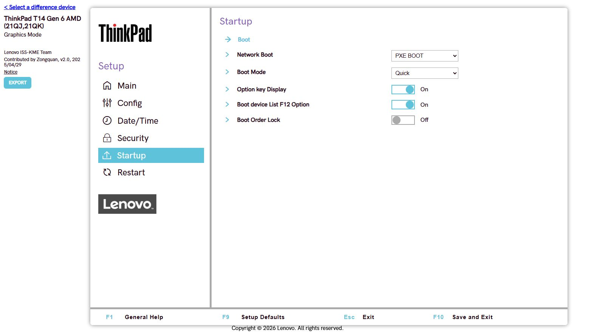
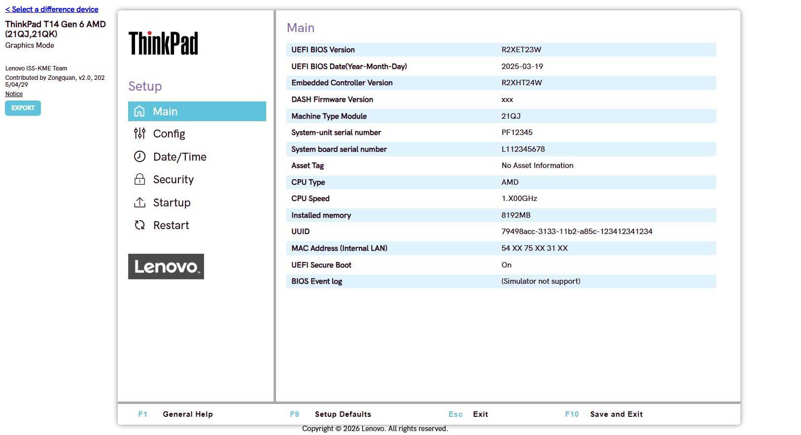
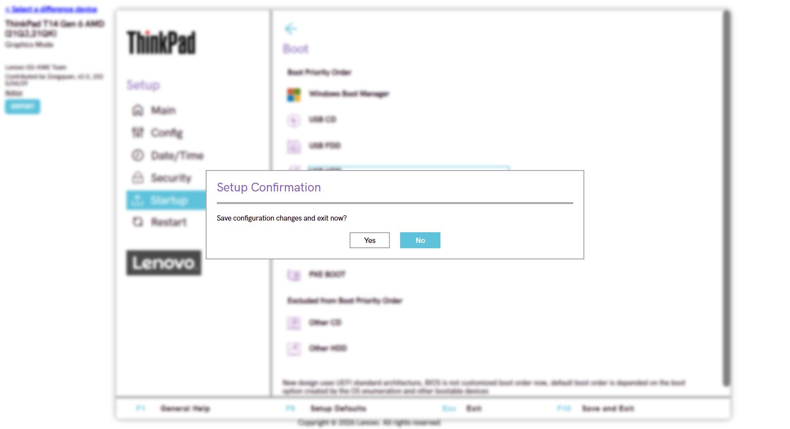

# Практика BIOS/UEFI

## 1. Навигация по UEFI

Открыл Main, Config, Security, Startup и Restart.

## 2. Порядок загрузки

## 3. Secure Boot

## 4. Пароль супервизора

В **Security → Password → Supervisor Password** установил тестовый пароль. При попытке что то сделать требуется ввод пароля.

## 5. Заводские настройки

В **Restart → Load Factory Defaults** подтвердил сброс. Невозможно нет в симуляторе.

## 6. Питание USB

В **Config → USB → Always On USB** выключил и снова включил постоянное питание USB.

## 7. Режим контроллера SATA/NVMe

Проверил **Config**. В симуляторе пункт Storage отсутствует.

## 8. Временное меню загрузки F12

В **Startup → Boot device List F12 Option** выключил и снова включил опцию. F12 в симуляторе не открыл.

## 9. Журнал событий

Simulator not support

## 10. Подготовка к переустановке ОС

Сбросил настройки, Secure Boot включён и тестовый пароль. Проверил Boot, нажал **F10 → Yes**. В симуляторе полностью проверить невозможно.

