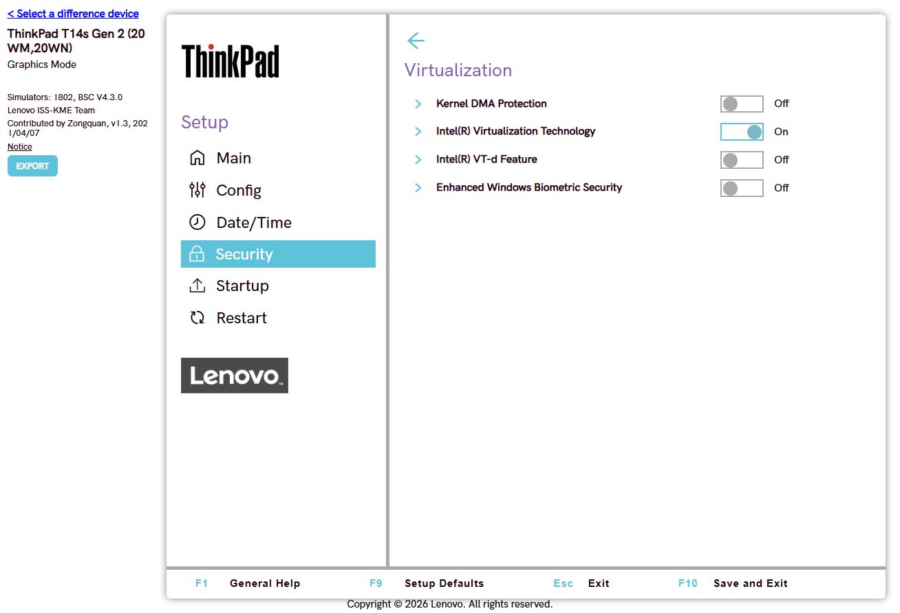
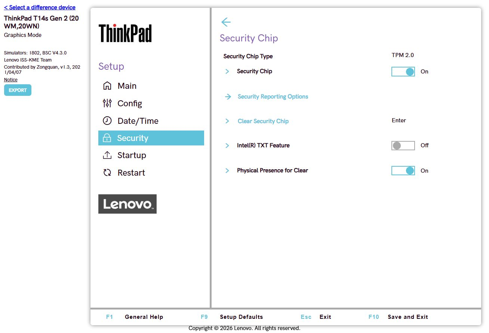
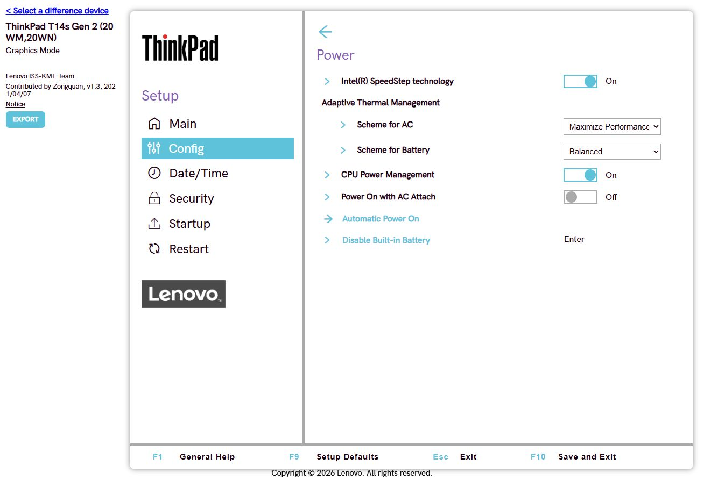
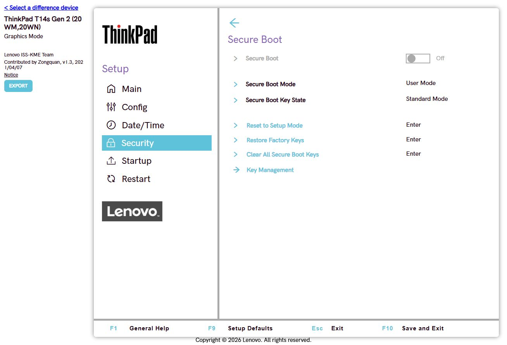
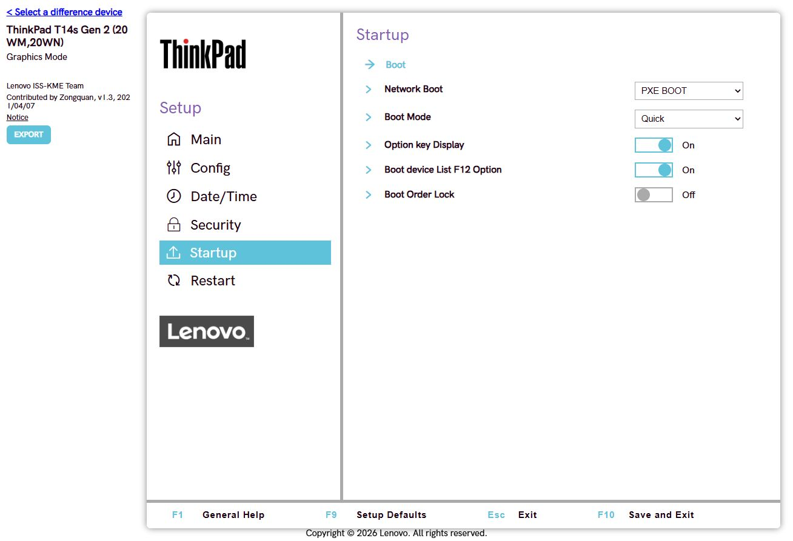
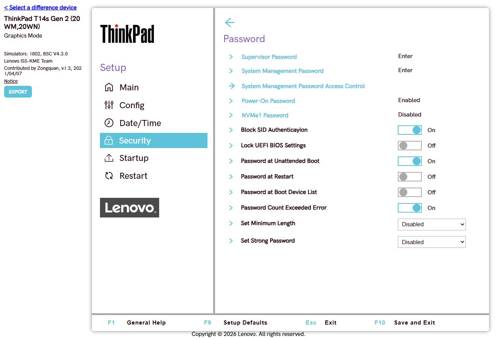
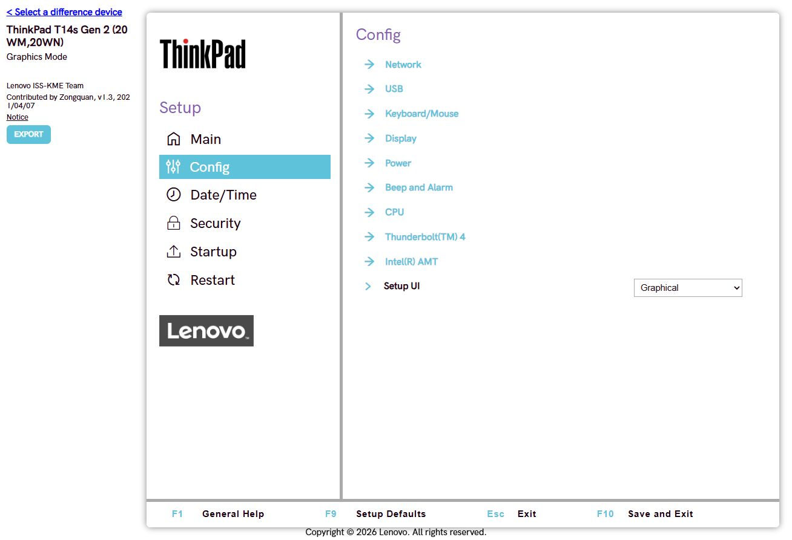
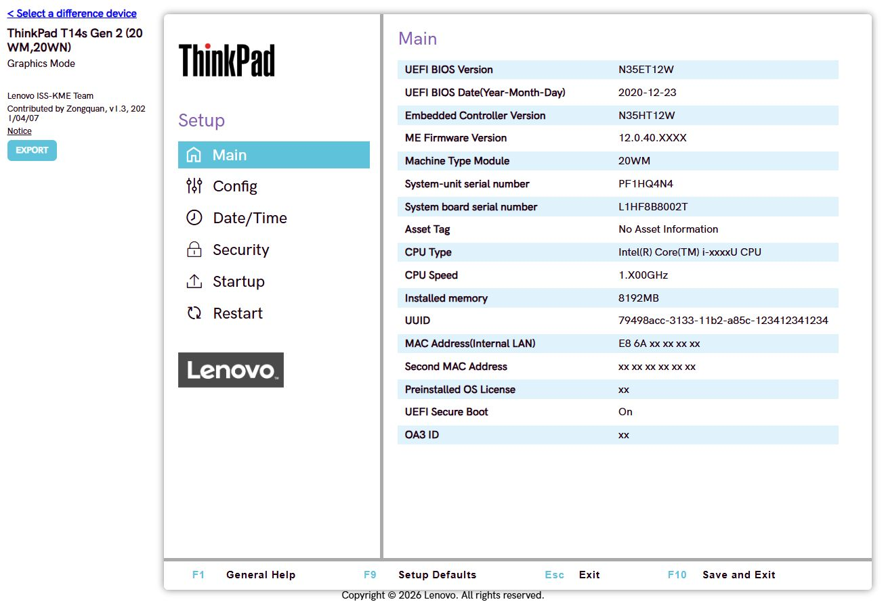
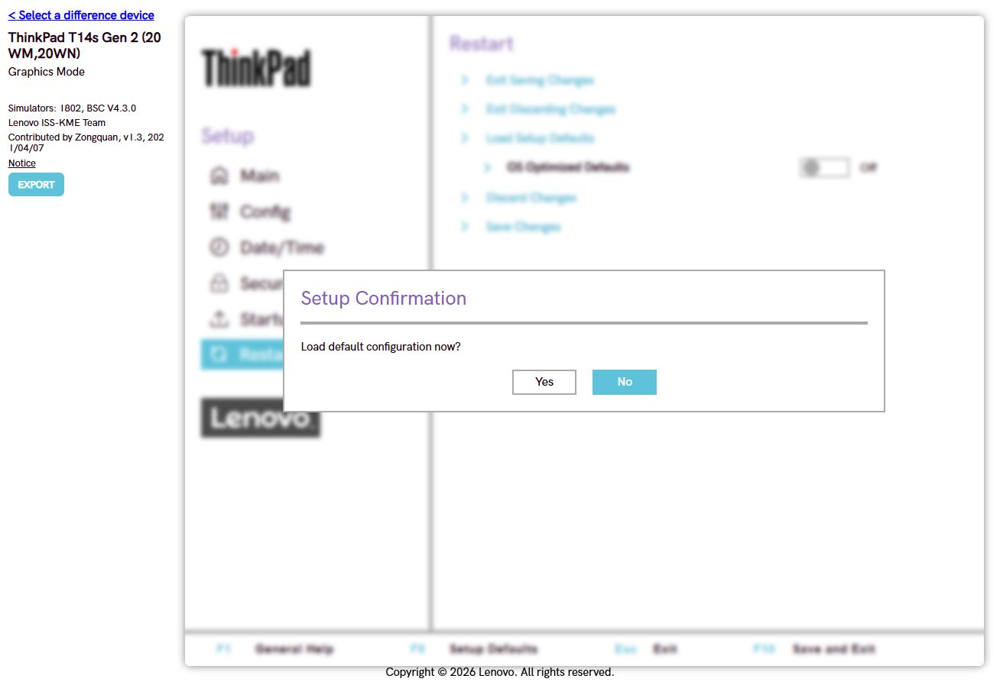
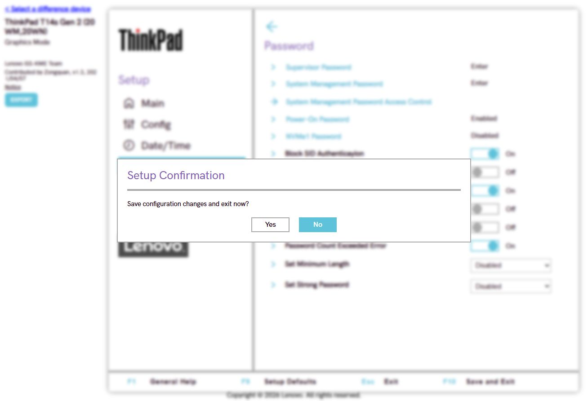

# Домашние задание № 10

## Что надо было сделать

Ниже представлены 10 практических заданий по BIOS/UEFI

Все задания можно выполнить в **Lenovo BIOS Simulator Center** ([https://download.lenovo.com/bsco/index.html](https://download.lenovo.com/bsco/index.html)), выбрав модель ThinkPad или ThinkCentre.

### Задача 1. Включение аппаратной виртуализации (Intel VT-x / AMD-V)

**Цель:** Научиться находить и активировать поддержку виртуализации — обязательное условие для работы VMware, Hyper-V и VirtualBox.

**Задание:** Перейдите в **Config → CPU** (или **Advanced → CPU Setup**). Найдите опцию **Intel Virtualization Technology** или **AMD-V**. Запишите текущее состояние (Enabled/Disabled). Если выключено — включите. Запишите точный путь к настройке.

**Критерий готовности:** Вы можете без подсказки указать, где включается виртуализация на устройстве Lenovo, и объяснить, зачем она нужна .

### Задача 2. Проверка статуса TPM и его связь с BitLocker

**Цель:** Понять, где находится TPM и почему без него не работает шифрование диска Windows.

**Задание:** Перейдите в **Security → Security Chip** (или **Trusted Platform Module**). Проверьте текущее состояние (Enabled/Disabled). Если TPM отключён — включите его. Обратите внимание, требуется ли перезагрузка для применения. Запишите, в каком разделе меню находится эта опция.

**Критерий готовности:** Вы знаете путь к TPM и можете объяснить, что произойдёт с BitLocker при отключении TPM .

### Задача 3. Настройка поведения при потере питания (After Power Loss)

**Цель:** Отработать настройку, критически важную для серверов и удалённых рабочих станций.

**Задание:** Перейдите в **Power → After Power Loss** (или **AC Power Recovery**). Посмотрите доступные варианты: **Power Off**, **Power On**, **Last State**. Выберите **Power On**, затем верните **Last State**. Запишите, какой вариант стоит по умолчанию.

**Критерий готовности:** Вы понимаете разницу между тремя режимами и можете выбрать правильный для сценария «сервер в удалённой стойке» .

### Задача 4. Отключение Secure Boot и проверка последствий

**Цель:** Понять, что происходит при отключении Secure Boot и когда это может понадобиться.

**Задание:** Перейдите в **Security → Secure Boot**. Переключите в **Disabled**. Обратите внимание, появляется ли предупреждение о рисках. Попробуйте найти, где отображается **Secure Boot Status** (Platform Mode, Secure Boot Mode). Затем верните **Enabled**.

**Критерий готовности:** Вы можете назвать две ситуации, когда требуется отключить Secure Boot (например, загрузка с неподписанного USB или установка некоторых версий Linux) .

### Задача 5. Настройка порядка загрузки через Fast Boot

**Цель:** Понять, как Fast Boot влияет на доступ к меню загрузки и USB-устройствам.

**Задание:** Перейдите в **Startup → Fast Boot**. Если включено — отключите. Затем проверьте, изменилось ли что-то в доступности **Boot Menu** (F12). Включите Fast Boot обратно. Запишите, что изменилось.

**Критерий готовности:** Вы можете объяснить, почему при включённом Fast Boot компьютер иногда «не видит» загрузочную флешку .

### Задача 6. Установка пароля на включение (Power-On Password)

**Цель:** Отработать установку пароля, который запрашивается до загрузки ОС — базовый уровень физической безопасности.

**Задание:** Перейдите в **Security → Password → Power-On Password**. Установите пароль `Boot1234`. Выйдите с сохранением (F10). При повторном входе в симулятор проверьте, запрашивается ли пароль. Затем сбросьте его, введя текущий.

**Критерий готовности:** Вы знаете разницу между Power-On Password и Supervisor Password и можете объяснить, когда нужен каждый из них.

### Задача 7. Настройка SATA Controller Mode для установки ОС

**Цель:** Понять, как режим контроллера влияет на видимость диска при установке Windows.

**Задание:** Перейдите в **Config → Storage → SATA Controller Mode** (или **NVMe Mode**). Посмотрите варианты: **AHCI**, **RAID**, **Intel RST**. Переключите с **AHCI** на **RAID**, затем обратно. Обратите внимание на предупреждение о возможной потере данных при смене режима.

**Критерий готовности:** Вы можете объяснить, почему при смене режима SATA установленная Windows может перестать загружаться .

### Задача 8. Просмотр и очистка системного журнала событий (Event Log)

**Цель:** Научиться диагностировать проблемы через встроенный журнал UEFI.

**Задание:** Перейдите в **Main → System Summary** или **Config → Diagnostics**. Найдите раздел **Event Log** (или **System Event Log**). Просмотрите последние записи. Найдите опцию **Clear Event Log** и выполните очистку. Запишите, какие типы событий обычно фиксируются (ошибки POST, изменения конфигурации).

**Критерий готовности:** Вы знаете, где искать журнал, и можете назвать хотя бы одну причину, по которой стоит его очистить перед передачей устройства .

### Задача 9. Восстановление заводских настроек с сохранением пользовательских данных

**Цель:** Отработать разницу между `Load Factory Defaults` и `Reset System to Factory Defaults`.

**Задание:** Перейдите в **Restart → Load Factory Defaults**. Подтвердите. Затем найдите в **Security** опцию **Reset System to Factory Defaults**. Прочитайте предупреждение (обычно требует отключения Absolute Persistence и удаления паролей NVMe). Не выполняйте сброс — просто зафиксируйте разницу между двумя опциями.

**Критерий готовности:** Вы можете объяснить, в каком случае используется `Load Factory Defaults`, а в каком — полный сброс системы .

### Задача 10. Полный сценарий: подготовка нового сотрудника (IT-администратор)

**Цель:** Закрепить все навыки в реалистичном рабочем сценарии.

**Задание (последовательно):**

1. Включить **аппаратную виртуализацию** (для будущих VM).
2. Включить **TPM** (для BitLocker).
3. Установить **Power-On Password** (физическая защита).
4. Отключить **Fast Boot** (чтобы сотрудник мог загрузиться с USB при необходимости).
5. Настроить **After Power Loss → Power On** (рабочая станция должна включаться после сбоя питания).
6. Сохранить и выйти (F10). При повторном входе проверить все настройки. Затем сбросить пароль и вернуть Fast Boot.

**Критерий готовности:** Все шесть шагов выполнены без подсказок, настройки проверены после повторного входа.

## Решение

Модель в симуляторе Lenovo: **ThinkPad T14s Gen 2**, графический режим.

### Задача 1. Аппаратная виртуализация

В **Security → Virtualization** включил **Intel Virtualization Technology**. Было **Off**, стало **On**. Эта настройка нужна для запуска виртуальных машин.

### Задача 2. TPM и BitLocker

В **Security → Security Chip** проверил TPM 2.0. Он уже был включён, поэтому перезагрузка не понадобилась. Если отключить TPM на ПК с BitLocker, Windows может запросить ключ восстановления.

### Задача 3. Восстановление питания

Проверил **Config → Power**. В графическом симуляторе нет пункта **After Power Loss**, поэтому режимы не переключал. Для сервера после сбоя подошёл бы **Power On**.

### Задача 4. Secure Boot

Открыл **Security → Secure Boot**. Переключатель в симуляторе недоступен. На экране видны **User Mode** и **Standard Mode**. Отключение Secure Boot может понадобиться для загрузки с неподписанной флешки или установки ОС с неподписанным загрузчиком.

### Задача 5. Fast Boot

В **Startup** нашёл **Boot Mode** со значением **Quick** и включённую опцию меню F12. Отдельного пункта **Fast Boot** в графическом симуляторе нет, поэтому сравнить работу F12 до и после отключения не получилось.

### Задача 6. Пароль включения

В **Security → Password** установил тестовый **Power-On Password**. Статус сменился на **Enabled**. Подтвердил **F10 → Yes**, но симулятор остался в BIOS и не запросил пароль. После **Load Setup Defaults** статус **Enabled** исчез. Пароль включения защищает запуск компьютера, а **Supervisor Password** защищает настройки BIOS.

### Задача 7. Режим SATA

Проверил **Config**. В графическом симуляторе нет раздела **Storage**, поэтому переход с AHCI на RAID пропустил. После смены режима Windows может не загрузиться, если у неё нет нужного драйвера контроллера.

### Задача 8. Журнал событий

Проверил **Main** и **Config**. В графическом симуляторе нет доступного журнала событий, поэтому просмотреть и очистить записи не получилось.

### Задача 9. Заводские настройки

В **Restart** выбрал **Load Setup Defaults** и подтвердил загрузку настроек BIOS по умолчанию. Пункта **Reset System to Factory Defaults** в графическом симуляторе нет, поэтому его предупреждение посмотреть не получилось.

### Задача 10. Подготовка компьютера

Включил виртуализацию, проверил TPM и установил тестовый пароль. Подтвердил **F10 → Yes** и проверил эти три настройки в текущем сеансе. После обновления страницы виртуализация и пароль вернулись к исходному состоянию. Шаги с **Fast Boot** и **After Power Loss** пропустил, их нет в графическом симуляторе.

