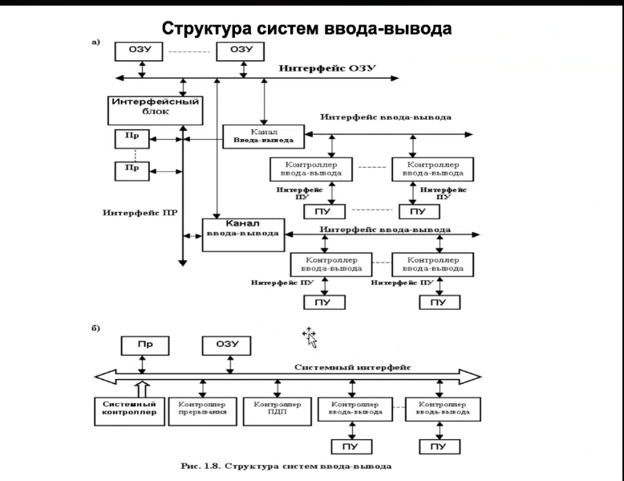

# Практические задания по теме «Системы ввода-вывода и интерфейсы»

## Задача 1. Терминология и определения (5 мин)

**Задание:** Установите соответствие между понятием и его определением. Запишите ответ в формате: 1–А, 2–Б и т.д.

| Понятие | Определение |
|---|---|
| 1. Система ввода-вывода (СВВ) | А. Группа линий интерфейса, соответствующая определённому функциональному назначению (данные, адрес и т.п.) |
| 2. Интерфейс | Б. Совокупность всех линий интерфейса |
| 3. Магистраль | В. Средства и правила, обеспечивающие взаимосвязь устройств между собой |
| 4. Шина | Г. Средства взаимосвязи и передачи информации, объединяющие ЦПр, ОЗУ и ПУ |
| 5. Канал | Д. Электрический проводник, по которому распространяется сигнал |
| 6. Линия интерфейса | Е. Среда передачи информации в виде определённых сигналов |

---

## Задача 2. Классификация интерфейсов (7 мин)

**Задание:** Заполните таблицу, распределив перечисленные характеристики по видам интерфейсов. Для каждого пункта укажите, к какому признаку классификации он относится.

**Данные для распределения:**
1. Параллельный
2. Симплексный
3. Синхронный
4. Последовательный
5. Полудуплексный
6. Асинхронный
7. Дуплексный
8. Трёхшинный
9. Двухшинный

| Признак классификации | Варианты |
|---|---|
| По способу передачи данных | |
| По организации обмена | |
| По способу синхронизации | |
| По архитектуре (параллельный интерфейс) | |

---

## Задача 3. Расчёт скорости передачи (8 мин)

**Задание:** Решите две задачи.

**а)** Параллельный интерфейс работает на частоте синхроимпульсов f = 100 МГц. Разрядность данных N = 16 бит. Определите скорость передачи в бит/с и байт/с.

**б)** Последовательный интерфейс работает на частоте f = 2,5 ГГц. Определите скорость передачи в бит/с и байт/с.

**в)** Сравните результаты и объясните, почему в современной технике всё шире используются последовательные интерфейсы, несмотря на то что за один такт они передают меньше данных.

---

## Задача 4. Задатчик и исполнитель (10 мин)

**Задание:** Проанализируйте схему управления обменом информацией (рис. 1.3) и ответьте на вопросы.

1. Кто всегда является задатчиком (Master), а кто — исполнителем (Target) в системе «процессор – ОЗУ»?
2. Может ли периферийное устройство быть и задатчиком, и исполнителем? Приведите пример.
3. Чем отличается операция записи от операции чтения с точки зрения направления передачи данных?
4. Зачем функции управления вводом-выводом распределяются между несколькими устройствами (процессор, главный контроллер/канал, контроллер ПУ, блок управления ПУ)?

---

## Задача 5. Анализ структуры системы ввода-вывода (10 мин)

**Задание:** Рассмотрите две структуры систем ввода-вывода (рис. 1.8, а и б) и выполните задания.

1. Назовите основные компоненты каждой структуры.
2. В чём принципиальное отличие структуры «а» от структуры «б»?
3. Какая структура, по вашему мнению, характерна для современных персональных компьютеров? Обоснуйте ответ.
4. Какую роль в структуре «б» играет системный контроллер и контроллер прерывания?

## Решение

### Задача 1

1–Г, 2–В, 3–Б, 4–А, 5–Е, 6–Д.

### Задача 2

| Признак классификации | Варианты |
|---|---|
| По способу передачи данных | Параллельный (1), последовательный (4) |
| По организации обмена | Симплексный (2), полудуплексный (5), дуплексный (7) |
| По способу синхронизации | Синхронный (3), асинхронный (6) |
| По архитектуре (параллельный интерфейс) | Трёхшинный (8), двухшинный (9) |

### Задача 3

**а)** V = f × N = 100 × 10⁶ × 16 = **1,6 × 10⁹ бит/с** = **200 × 10⁶ байт/с (200 МБ/с)**.

**б)** V = f = **2,5 × 10⁹ бит/с** = **312,5 × 10⁶ байт/с (312,5 МБ/с)**.

**в)** Последовательный интерфейс быстрее в 1,5625 раза. У него меньше линий и проще соединение.

### Задача 4

1. Процессор — задатчик, ОЗУ — исполнитель.
2. Да. Сетевая карта — исполнитель при настройке её регистров, задатчик при обмене с ОЗУ через DMA.
3. Запись: данные идут от задатчика к исполнителю. Чтение: от исполнителя к задатчику.
4. Это снижает нагрузку на процессор и позволяет устройствам работать параллельно.

### Задача 5

1. **«а»:** процессоры, ОЗУ, интерфейсный блок, каналы ввода-вывода, контроллеры и ПУ. **«б»:** процессор, ОЗУ, системный интерфейс, системный контроллер, контроллеры прерываний, ПДП и ввода-вывода, ПУ.
2. В «а» обмен организуют отдельные каналы через несколько интерфейсов. В «б» узлы подключены к общему системному интерфейсу.
3. Ближе структура «б»: в ПК применяются контроллеры, прерывания и прямой доступ к памяти. Часть связей реализована по схеме «точка-точка».
4. Системный контроллер формирует сигналы управления обменом. Контроллер прерываний принимает запросы устройств, определяет их приоритет и передаёт запрос процессору.
